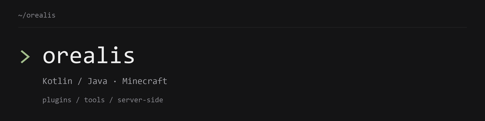

Разрабатываю инструменты для Minecraft на Kotlin и Java

```text
stack    Kotlin · Java 21 · Gradle
server   Paper · UniverseSpigot
focus    API плагинов · инвентарные меню
```

### Проекты

**[AdrenalinGUI](https://github.com/chotaktota/AdrenalinGUI)**  
Kotlin DSL для инвентарных меню: символьные раскладки, именованные страницы, кэширование и обработчики кликов

[Документация](https://github.com/chotaktota/AdrenalinGUI/blob/main/README.ru.md) · [Релизы](https://github.com/chotaktota/AdrenalinGUI/releases) · [Обсуждение ошибок](https://github.com/chotaktota/AdrenalinGUI/issues)

### Форки

[Saphire](https://github.com/chotaktota/Saphire) — форк Leaf, серверного ядра на базе Paper  
[DeltaClient](https://github.com/chotaktota/DeltaClient) — форк CollapseLoader/DeltaClient

